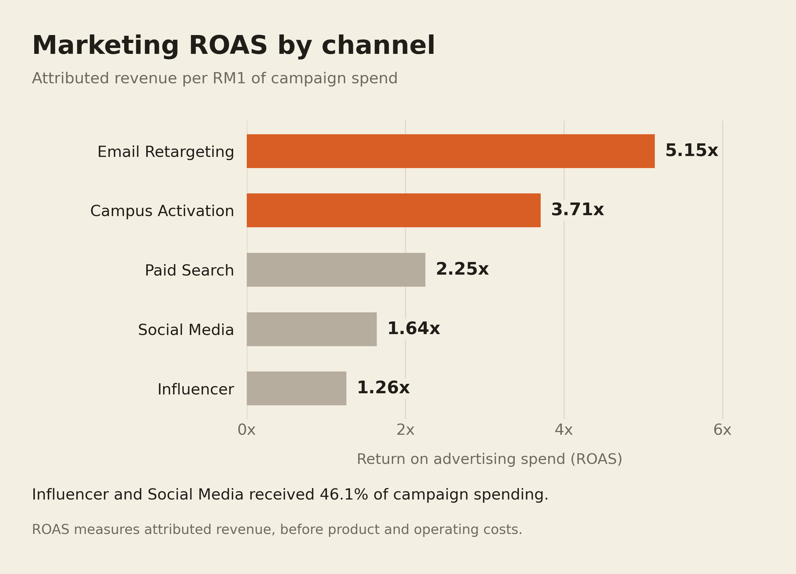
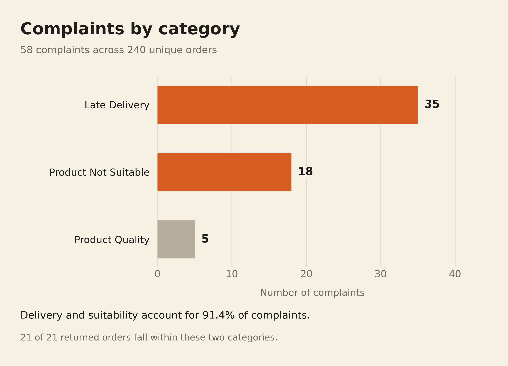
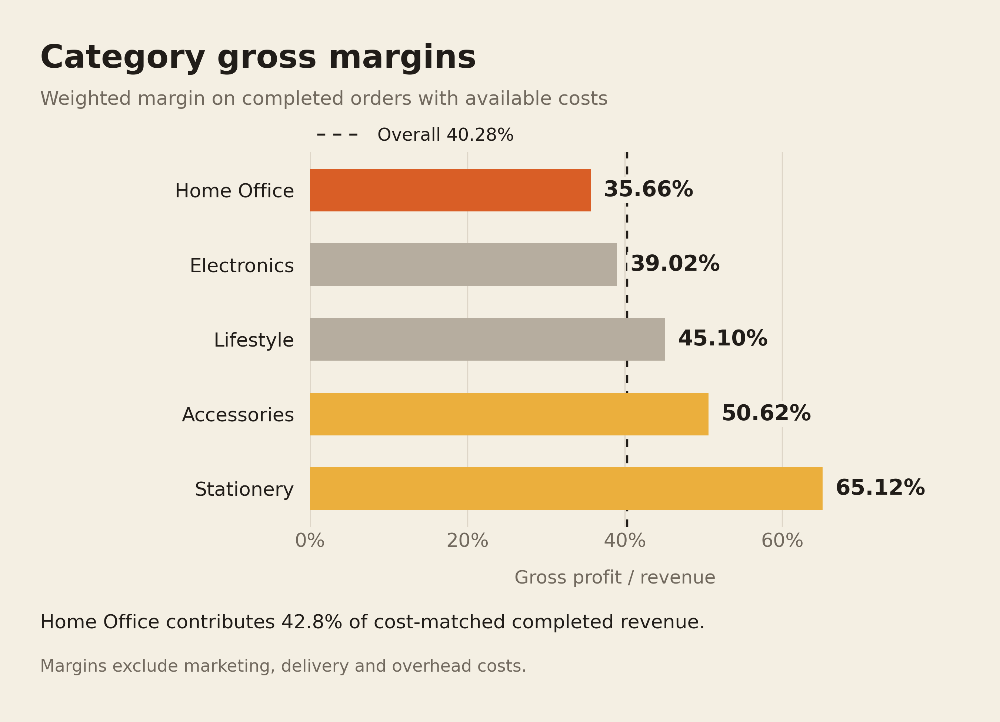

# Group 41 NexaMart

The workbook and Power BI report support the Kampus Digital business performance challenge.

## Recommendation figures

Three charts accompany the marketing, customer experience and product profitability recommendations. The figures contain historical results. Proposed trial targets remain in the presentation text.

| Figure | PNG for slides | SVG with editable text |
| --- | --- | --- |
| Marketing ROAS | [PNG](figures/recommendations/01_marketing_roas.png) | [SVG](figures/recommendations/01_marketing_roas.svg) |
| Customer complaints | [PNG](figures/recommendations/02_customer_complaints.png) | [SVG](figures/recommendations/02_customer_complaints.svg) |
| Category gross margin | [PNG](figures/recommendations/03_category_gross_margin.png) | [SVG](figures/recommendations/03_category_gross_margin.svg) |

The PNGs use the slide's cream background (`#F4EFE3`) and export at 2700 x 1950 pixels. The SVG backgrounds are transparent. Orange highlights the main comparison and amber identifies the suggested add-on categories. All bars start at zero. Use a chart beside two or three recommendation points.







## Rebuild

Use Python 3.10 or later. From the repository root:

```bash
python -m pip install -r scripts/requirements-figures.txt
python scripts/build_recommendation_figures.py
```

An updated workbook can be passed explicitly:

```bash
python scripts/build_recommendation_figures.py --workbook "updated.xlsx" --output-dir figures/recommendations
```

The script reads the workbook without modifying it. It exports three PNGs, three SVGs, three CSV tables and `metrics.json`. Calculations use the raw sheets, so stale cached summary formulas do not determine the figures. SVG text remains editable. The script and pinned dependencies reproduce the charts without an image generation service.

The downloadable figures bundle does not contain another copy of the workbook. When using that bundle, pass the path to your existing Excel file with `--workbook`, as in the command above.

## Calculation definitions

- **Marketing ROAS** is total attributed campaign revenue divided by total campaign spend for each channel. It does not establish channel profit. Influencer and Social Media receive 46.1% of the recorded budget.
- **Complaints** include all 240 unique orders, with the exact duplicate order removed. The script normalises `late delivery` to `Late Delivery`. Of 58 complaints, 35 concern late delivery and 18 concern product suitability. These categories account for 53/58 complaints, or 91.4%, and contain all 21 returned orders. The complaint share does not predict how many complaints a corrective action will prevent.
- **Category gross margin** is summed gross profit divided by summed revenue, using completed orders with recorded product costs. The financial population contains 207 orders, RM57,609.65 revenue, RM34,407.00 product cost and RM23,202.65 gross profit. Its weighted margin is 40.28%. One completed P999 order with RM716.40 revenue has no product cost and is excluded from both the margin numerator and denominator. That order remains in service counts.
- **Home Office revenue share** uses the same cost-matched financial population as the margin comparison. Its RM24,654.00 revenue represents 42.8% of that population. Category margins exclude marketing, delivery and overhead costs.

Missing customer segments and satisfaction ratings do not remove orders from the complaint chart. Missing ratings are not assigned numerical scores. No region labels are recoded for these figures.

The CSV files contain the plotted values. `metrics.json` also records the source workbook's SHA-256 digest, duplicate count and financial exclusions. The original source workbook and PBIX report remain unchanged.
